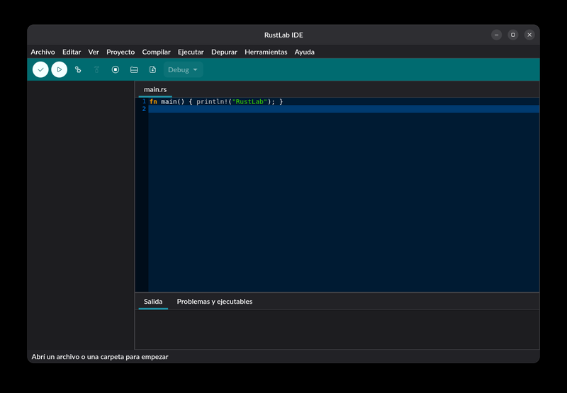

# RustLab IDE

Entorno de desarrollo nativo para Rust en Debian, con interfaz en español y una barra de herramientas inspirada en Arduino IDE. Usa GTK4, libadwaita y GtkSourceView. Cargo y rust-analyzer proveen las herramientas de compilación y autocompletado.



## Qué podés hacer

- Abrir proyectos y workspaces Cargo, recorrer su árbol de archivos y consultar sus ramas Git.
- Crear aplicaciones de consola, bibliotecas, workspaces y proyectos a partir de plantillas GTK4 y Cortex-M.
- Editar con autocompletado semántico, snippets, importaciones automáticas, cierre de delimitadores y sangría automática.
- Verificar, compilar y ejecutar con el perfil Debug o Release. El IDE guarda los cambios del proyecto antes de iniciar estas acciones.
- Ver la salida de Cargo en directo, abrir diagnósticos en el editor y localizar los ejecutables generados.
- Elegir un tema de colores y restaurar el proyecto y las pestañas al reabrir.

## Instalar o compilar

La plataforma probada es **Debian 13 amd64**. Descargá el instalador desde [Releases](../../releases/latest). Para compilar, cloná el repositorio desde **Code** y ejecutá los comandos desde su raíz. Instalá Rust estable con Cargo y agregá rust-analyzer para activar el autocompletado.

```bash
sudo apt install build-essential pkg-config libgtk-4-dev libadwaita-1-dev libgtksourceview-5-dev
rustup component add rust-analyzer --toolchain stable
cargo run --locked -p rustlab-app
```

### Generar e instalar el paquete Debian

```bash
sudo apt install dpkg-dev
bash scripts/build-deb.sh
sudo apt install ./target/debian/rustlab-ide_0.1.0-1_amd64.deb
```

Una vez instalado, abrí **RustLab IDE** desde el menú de aplicaciones o ejecutá `rustlab-ide`.

## Desarrollo

```bash
cargo fmt --all -- --check
cargo clippy --workspace --all-targets --locked -- -D warnings
cargo test --workspace --locked
# En una sesión gráfica
cargo test -p rustlab-editor -p rustlab-ui --locked -- --ignored
# Con rust-analyzer instalado
cargo test -p rustlab-lsp --locked -- --ignored
```

RustLab está en desarrollo. La compilación y la edición de proyectos Cargo ya se pueden usar. La depuración con LLDB, las acciones avanzadas de Git y la distribución multiplataforma figuran en la hoja de ruta.

- [Arquitectura](ARQUITECTURA.md)
- [Especificación funcional](ESPECIFICACION_FUNCIONAL.md)
- [Estado del proyecto](ESTADO.md)
- [Hoja de ruta](HOJA_DE_RUTA.md)
- [Criterios de aceptación](CRITERIOS_ACEPTACION.md)
